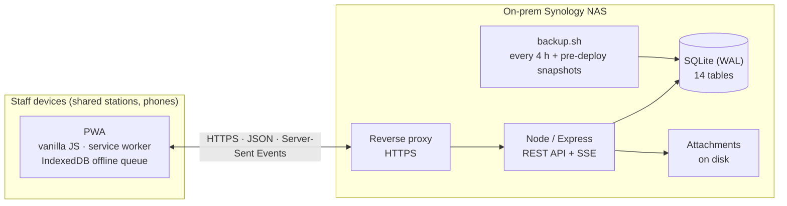
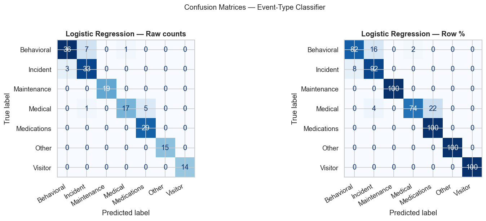
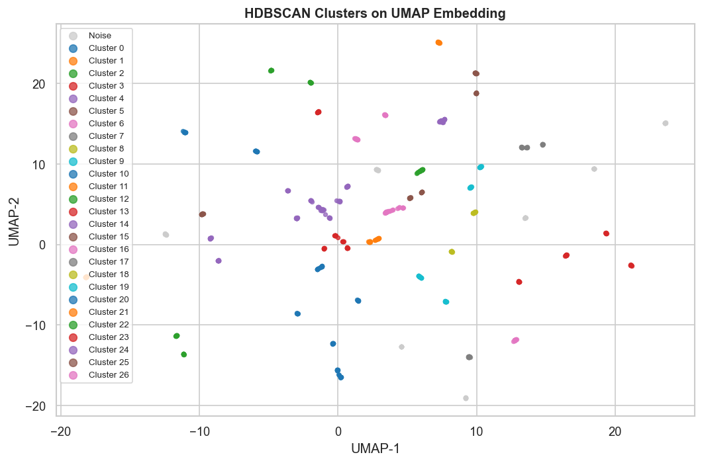

# Shift & Incident Log

A self-hosted shift log and behavioral-incident tracker built for a multi-campus residential substance-use-disorder treatment provider. Staff on three campuses use it daily on shared stations and phones to document each shift, hand off to the next one, and issue and track rule infractions for clients. All client records stay on the organization's own hardware.

I built and run it end to end: product design with the clinical team, frontend, backend, database, deployment, backups and ongoing releases (70+ versions to date).

> **About this repository.** This is a scrubbed portfolio copy of the production code. The organization, campus names, staff names, PINs and infrastructure details have been replaced, and every name in the screenshots and seed data is fictional. No client data was ever used to make it.

---

## Highlights

| | |
|---|---|
| **Privacy by architecture** | Holds client treatment records covered by **42 CFR Part 2**, so nothing goes to a third-party cloud. I migrated it off Supabase and GitHub Pages onto a single Docker container on the organization's Synology NAS. |
| **Offline-first PWA** | Installable app with a service worker. Entries submitted with no connection are queued in IndexedDB (files included) and sync when the device reconnects. |
| **Idempotent writes** | Every entry carries a client-generated UUID backed by a partial unique index, so retries, double-taps and offline-queue replays can never create duplicate records. I built this after a real production bug. |
| **Realtime** | Server-Sent Events push new entries, comments, notifications and handoffs to every open station instantly. |
| **Audit trail everywhere** | Edits to log entries, infractions and client profiles are recorded field by field (who, when, from → to). Deletes are soft and restorable, to satisfy record-retention rules. |
| **Built for shared stations** | PIN sign-in, a 10-minute idle sign-out with a countdown warning, and per-user drafts saved on the server, so one person's half-written note never appears for the next person. |
| **Data science** | An analytics dashboard, plus an NLP research track (event-type classifier, severity model, anomaly detection, PII redaction, topic modeling) on a synthetic dataset I designed. Production keeps a lightweight, explainable on-prem scorer, switched off by default. |

## Features

### Shift log
- Structured entries: date, shift (derived from the time), campus, event type, narrative, follow-up and attachments (photos and documents).
- Voice-to-text dictation for narratives.
- Searchable, filterable log with unread markers, comment threads, and an in-app notification bell. Authors are notified when someone comments on or resolves their entry.
- Follow-ups any staff member can resolve, with resolution notes and an "overdue" flag.
- Edit your own entries; admins can edit, soft-delete and restore any entry and review its edit history.
- CSV export.

### Shift handoff
- Auto-generated handoff for a campus and shift: what happened, plus every open follow-up, oldest first.
- **Send and Received acknowledgement.** The outgoing shift sends it, the incoming shift marks it received, and the sender is notified. Admins see a handoff log that flags anything not received within 2 hours.

### Rule infractions (VW / WW / WU)
- Verbal Warning → Written Warning → Write-Up, with automatic **per-client, per-type numbering**. Numbering is atomic, and a voided infraction frees its number without ever duplicating one already issued.
- Consequences (paper, chores, therapeutic) with due dates, completion tracking, an Active Consequences board, and printable write-ups.
- Every infraction and completion automatically writes a linked entry to the shift log.
- Client roster (phases, clinician, campus, admit and discharge) and an editable rule catalog, so policy changes don't need a code deploy.
- Required-field validation enforced both in the UI and on the API.

### Dashboard
- KPI cards with period-over-period deltas and sparklines.
- Entries and event types over time, a day-of-week × hour heatmap, and campus and shift breakdowns.
- Infraction analytics: by type, rule, phase, shift and campus, infractions per client, and consequence completion.
- Click-through from any chart into the filtered log.
- Volume-spike alerts against each campus's own baseline (built, currently switched off in production).

## Architecture



- **Frontend** (`web/`): framework-free HTML, CSS and JavaScript PWA with Chart.js for charts. `db-shim.js` exposes the subset of the `supabase-js` API the app was originally written against and maps it onto the self-hosted REST API. That's how I moved off Supabase without rewriting the app.
- **Backend** (`backend/server.js`): one Express service serving the static app, about 45 JSON routes, attachments (with path-traversal protection) and an SSE stream. The schema is applied idempotently on startup, and columns are added with `PRAGMA`-guarded migrations.
- **Database:** SQLite in WAL mode via `better-sqlite3`. Multi-step writes such as infraction numbering run inside transactions.
- **Operations:** a single `docker compose` service. `backup.sh` takes consistent online snapshots (SQLite `.backup`) plus attachments every 4 hours, and a labeled, never-pruned snapshot before every deploy.

## Engineering notes

A few problems worth describing:

- **Duplicate entries from a JavaScript name collision.** A new helper accidentally shadowed an existing function with the same name. Submits then threw *after* the insert succeeded, so staff saw "failed", retried, and created duplicates. I fixed the bug, and then made writes idempotent (client UUID + unique index) so a frontend bug can't cause duplicates again.
- **Off-by-one dates.** `new Date("2026-10-12")` parses as UTC midnight, which shows as the previous day in Mountain time. Date-only strings are now parsed as local dates, and the container runs in the facility's time zone for server-stamped entries.
- **Infraction numbering.** "Count + 1" breaks when one in the middle is voided: WW#1 active, WW#2 voided, WW#3 active would hand out #3 twice. The next number is now `MAX(non-voided) + 1`, computed inside the insert transaction.
- **Shared-device privacy.** An idle sign-out used to leave the previous user's half-typed note on screen. Unsent drafts are now saved per user on the server, not in browser storage on a shared machine, and the form is cleared at sign-out.

## Data science (`ml-research/`)

Research notebooks built on a synthetic, labeled dataset (`generate_synthetic_data.py`). I designed it to be realistically imbalanced and ambiguous across classes, and some narratives have PII deliberately woven in.

| Notebook | What it covers |
|---|---|
| `event_type_classifier.ipynb` | TF-IDF + linear models (LogReg / SVM), class-imbalance handling, confusion matrices, error analysis |
| `severity_scoring.ipynb` | Severity classifier with text + event-type features, ablation study |
| `pii_redaction.ipynb` | spaCy NER + regex redaction, evaluated against the injected PII spans |
| `topic_modeling.ipynb` | TF-IDF → LSA (TruncatedSVD) → UMAP → HDBSCAN clustering of narrative themes |
| `train_anomaly.py` | Isolation Forest over LSA vectors for unusual narratives |

<p>
  
  
</p>

**What runs in production** is deliberately simpler. `backend/server.js` contains an on-prem scorer computed from the facility's own narratives: a multinomial Naive Bayes event-type suggestion, a safety-first severity lexicon that only ever *raises* a flag and never says "Low", and a rare-token anomaly score. It's transparent, needs no Python service, and is off until approved (`ML_ENABLED`). Trained model binaries aren't committed; the scripts regenerate them.

## Running it locally

Requires Docker.

```bash
docker compose up -d --build                                   # app on http://localhost:8086
docker compose exec shiftlog node seed-demo.js http://localhost:3000   # optional: fictional demo data
```

Sign in with a demo PIN: **1111** (admin), **3333** (staff), **7777** (limited "Client Location only" account). The demo PINs are defined in `web/script.js`.

## Security model and known limitations

- The app runs on an isolated on-site network behind HTTPS. Sign-in is a **client-side PIN gate**, and the API has no per-request authentication; the network boundary is the control. That was a deliberate trade-off for a LAN-only tool used on shared stations. Moving to server-side sessions or SSO is the first step before any wider exposure.
- PINs live in the frontend source in this design. The production table is kept out of this repository.

## Project structure

```
web/            PWA: index.html, script.js, style.css, sw.js, db-shim.js, vendored Chart.js + Inter
backend/        server.js (Express API + SSE), schema.sql, seed-demo.js, Dockerfile
ml-research/    synthetic data generator, notebooks, training scripts, result figures
docs/           feature spec for the infractions module, screenshots
backup.sh       online SQLite snapshot + attachments, rotation, labeled pre-deploy backups
```

---

Built by Simon Sealey.
